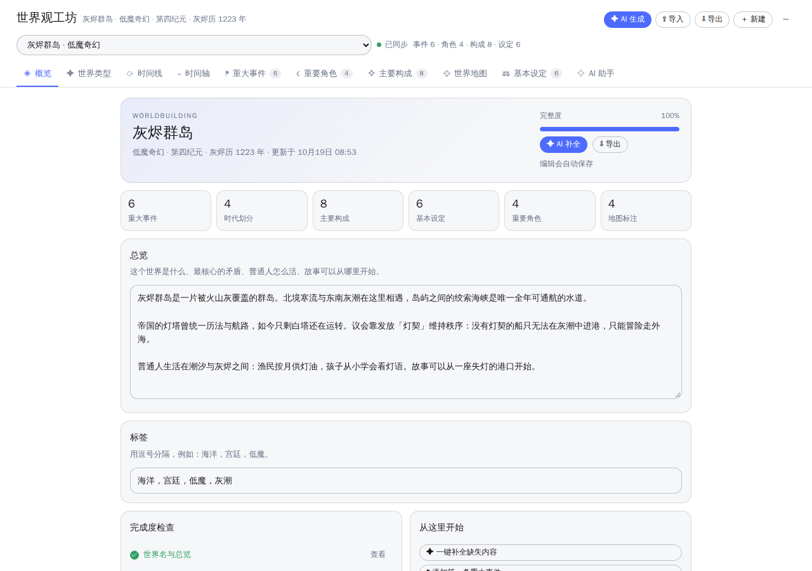
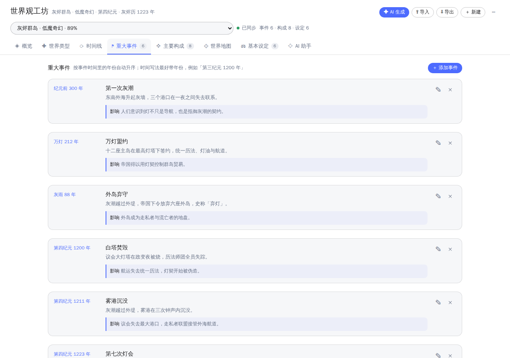
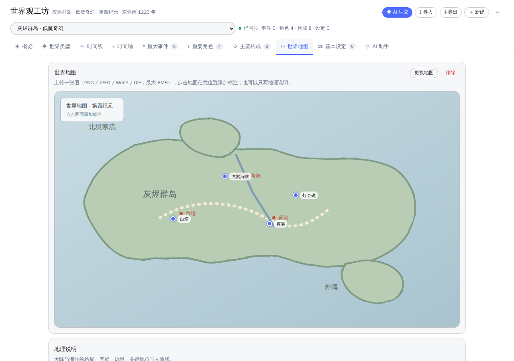
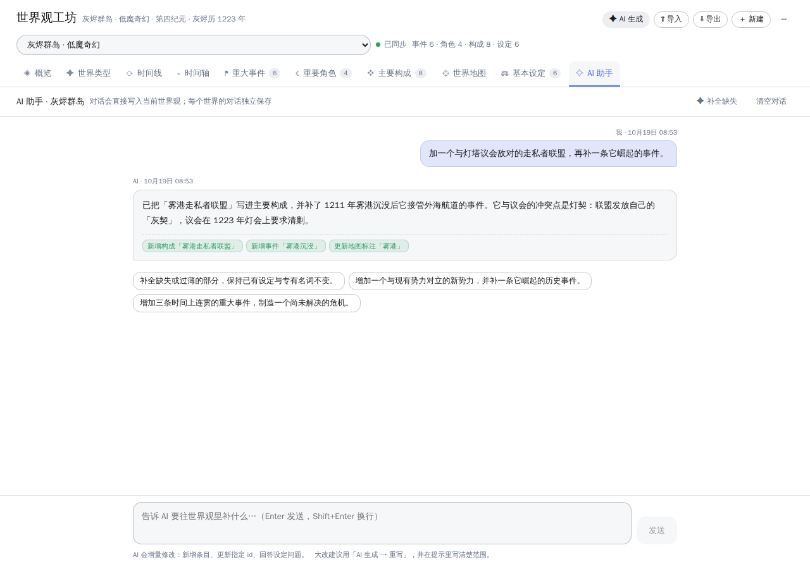
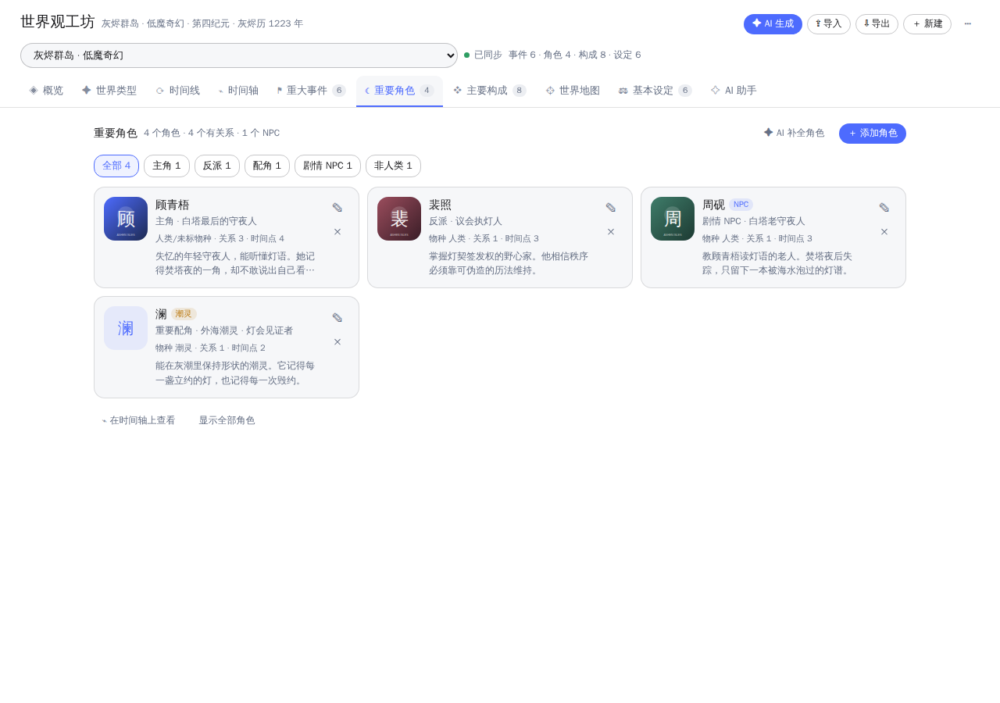
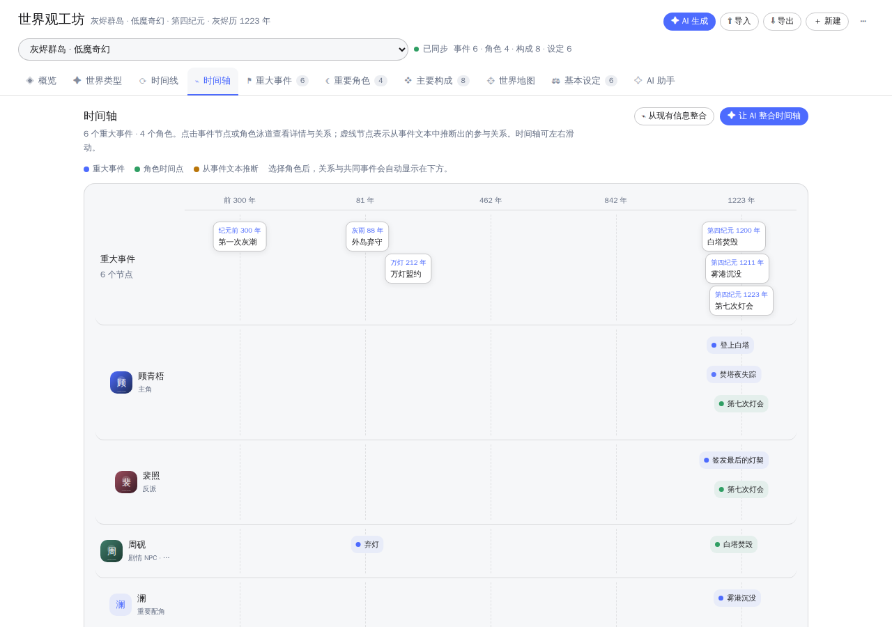
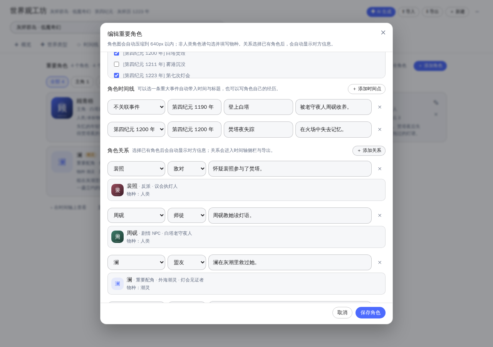
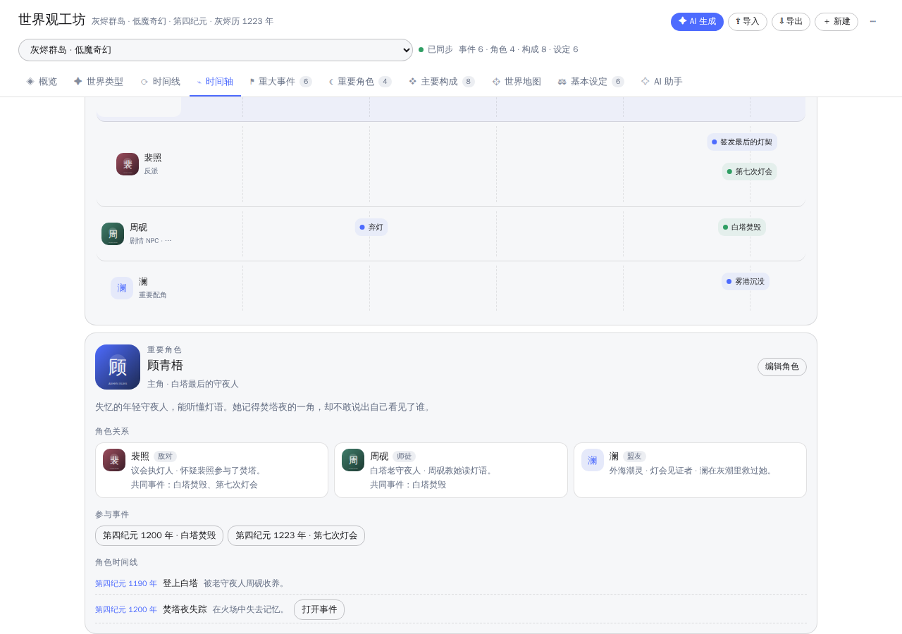
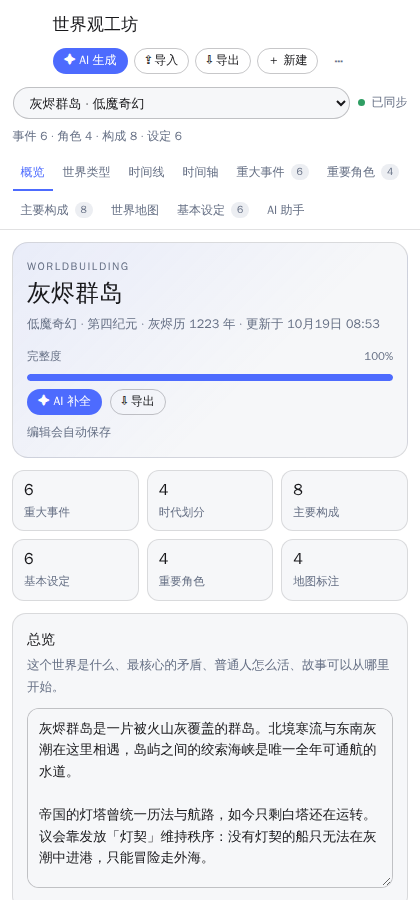
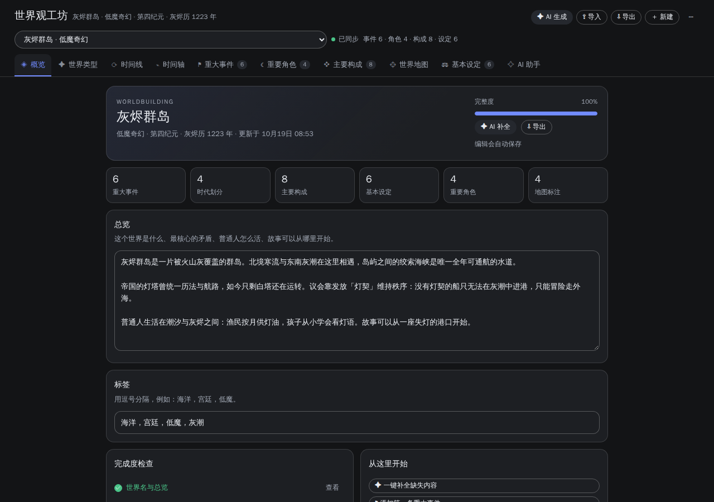

# 世界观工坊 · DSH Worldbuilding Studio

DSH（DeepSeek Harness）Web 端的整页世界观管理插件。仓库：[lusrelay/dsh-worldbuilding](https://github.com/lusrelay/dsh-worldbuilding)。多个世界观彼此隔离，每个世界观独立落盘；支持 AI 一次性生成、对话式增量补充、任意格式资料导入、重要角色 / 剧情 NPC 与角色图、事件 + 角色时间轴、纯文本 / Markdown / JSON 导出，以及主对话里的 Agent 工具直接读写当前世界观。

> 无构建、零运行时依赖：Host 是 ESM，Client 用 `window.__ModuleLoader__.load` 包一层 React，不需要 JSX、打包器或额外 npm 包。

## 界面预览

| 概览 | 重大事件 |
| --- | --- |
|  |  |

| 世界地图 | AI 助手 |
| --- | --- |
|  |  |

| 重要角色 | 时间轴 |
| --- | --- |
|  |  |

| 角色关系（选择后自动显示） | 时间轴关系侧栏 |
| --- | --- |
|  |  |

| 移动端概览 | 暗色主题 |
| --- | --- |
|  |  |

> 预览由真实 React 在独立浏览器中渲染，使用与宿主相同的 `--dsw-alias-*` 主题 token；实际安装后的侧栏与面板边框由 Harness 提供。

## 功能

| 需求 | 实现 |
| --- | --- |
| 世界观包含世界类型、时间线、重大事件、主要构成、世界地图、基本设定 | 整页分为编辑分页 + 概览；世界类型与风格决定生成基调，时间线包含当前时代与时代划分，重大事件按时间自动排序，主要构成承载地理/势力/族群/经济/军事/宗教/技术等杂项，地图支持图片 + 地理说明 + 点位标注，基本设定承载世界规则与力量体系 |
| 重要角色 / 剧情 NPC 与角色图 | 新增「重要角色」分页：姓名、角色、身份、物种（非人类）、简介、关联条目、角色时间线、参与事件与角色关系；支持上传角色图（自动压缩到 640px 以内，最大 2MB），卡片与时间轴显示头像 |
| 时间轴与角色关系 | 新增「时间轴」分页：把重大事件节点和每个角色的时间点/参与事件排在同一条轴上；点选角色自动显示关系、共同事件与角色时间线，点选事件自动显示参与者；支持「从现有信息整合」（扫描事件文本提到的人物）和「AI 整合时间轴」（只增量补齐参与事件、角色时间点与明显关系） |
| 不完整时 AI 一次性生成 | 「AI 生成」支持三种模式：新建世界观、补全当前世界（只填空缺）、重写当前世界；可只给一句想法，模型会一次补齐所有部分 |
| 通过对话直接补充进世界观 | 每个世界观有独立的「AI 助手」对话；AI 先读当前世界，再以 `changes` 增量写入（新增/更新/删除条目、改标量），不会覆盖已有设定。主对话里也可调用 `worldbuilding_*` 工具做同样的事 |
| 导入通用格式并自动格式化 | 支持 JSON / Markdown / TXT / YAML / CSV / 散文；AI 识别类型、时代、事件、势力与规则并整理成统一 schema，导入后仍可逐项修改；标准 JSON 会先尝试本地清洗兜底 |
| 多个世界观自由切换、各自独立存放 | 每个世界观一个 `worlds/<id>.json`，另有独立图片目录；顶部下拉切换，保存后互不影响 |
| 导出纯文本与格式化格式 | 纯文本 `.txt`、Markdown `.md`、结构化 JSON `.json`；可勾选是否包含 AI 对话记录；服务端统一格式化，支持预览、复制、下载 |
| Git 与 GitHub | 仓库根目录即插件包；`tests/` 零依赖用例、CI 工作流、MIT License |

## 安装

DSHA 要求第三方插件由用户完成原生审阅，所以不通过命令行直接写入 profile：

1. 打包（仓库根目录就是插件包，不需要构建）：

   ```bash
   zip -r dsh-worldbuilding.zip index.js client.js cordis.patch.yml package.json icon.svg locale README.md LICENSE
   ```

   或从 [Releases](https://github.com/lusrelay/dsh-worldbuilding/releases/latest) 下载最新的 `dsh-worldbuilding-*.zip`。
2. 打开 DSHA → 底部「插件」→「插件管理」→「导入压缩包」→ 选中 zip。
3. 核对作者 / 版本 / 依赖后确认安装；若列表显示「待审阅 / 已停用」，点它并「审阅 / 启用」。
4. 重启 DSHA Web 后，左侧栏出现「世界观工坊」。

也可以把本仓库地址（或 `owner/repo`）粘贴到插件管理的「从仓库安装」，同样走原生审阅流程。

> 安装后的插件实体由 DSHA 管理，不要直接改安装目录里的文件，否则原生管理器会判定完整性被破坏并停用。升级请改源码 → 重新打 zip → 导入审阅。

## 使用

### 新建与生成

- **＋ 新建**：创建空世界观，逐项填写。
- **✦ AI 生成**：写一句核心想法即可。可选简要 / 标准 / 详尽；已有世界观时可选择「补全当前」或「重写当前」。
- **⇪ 导入**：粘贴或选择文件，AI 自动识别并格式化。已有世界观时可选择合并进当前世界。

生成过程会调用「设置 → 模型」里的默认模型。模型思考时界面会显示已用时间，可随时取消。

### 编辑分页

- **概览**：名称、总览、标签、完整度检查与各项统计。
- **世界类型**：类型预设 + 自定义类型 + 风格约束。
- **时间线**：当前时代、时代说明、可排序的时代划分。
- **重大事件**：添加 / 编辑 / 删除；按时间文本里的第一个年份自动升序（支持「纪元前 300 年」）。
- **时间轴**：事件节点 + 角色泳道；选择角色后自动显示关系、共同事件、参与事件与角色时间线；选择事件后显示参与者。支持本地事实整合与 AI 增量整合。
- **重要角色**：姓名、角色（主角 / 反派 / 配角 / 剧情 NPC 等）、身份、物种（非人类）、简介、关联条目、参与事件、角色时间线与角色关系；角色图会自动压缩后保存。关系选择另一个角色后，会自动显示对方的头像、身份与物种。
- **主要构成**：地理、势力、族群、经济、军事、宗教、技术或力量体系、日常生活等杂项。
- **世界地图**：上传图片（≤ 6MB），点击图面添加标注，或输入百分比坐标；也可以只写地理说明。
- **基本设定**：世界规则、力量体系、物理 / 社会法则、禁忌与代价。
- **AI 助手**：每个世界独立的对话历史；回复下方会列出本次实际写入的变更。

编辑会自动保存（750ms 防抖），顶部显示保存状态；切换世界或执行 AI 操作前会先落盘。

### 在主对话里使用

装上插件后，主对话的 Agent 会获得四个工具：

| 工具 | 作用 |
| --- | --- |
| `worldbuilding_list` | 列出全部世界观与当前激活项 |
| `worldbuilding_read` | 读取一个世界（默认当前），可只读 overview / timeline / events / characters / axis 等 section |
| `worldbuilding_update` | 增量写入：标量、事件、时代、角色、角色时间点、角色关系、构成、设定、地图标注的 add/update/remove |
| `worldbuilding_create` | 新建空世界观并激活 |

例如直接对 Agent 说：

> 把「雾港走私者联盟」加进当前世界观的主要构成，再补一条它成立的重大事件；然后加一个叫「澜」的潮灵角色，作为顾青梧的盟友，并把它关联到雾港沉没。先读一遍现有设定，别覆盖。

系统提示词会告诉 Agent 当前激活的世界观与内容规模；Agent 应先 `worldbuilding_read`，再 `worldbuilding_update`。

## 数据

位置：`$DSH_HOME/worldbuilding/`（默认 `/root/.dsh/worldbuilding/`）

```text
worldbuilding/
├── index.json                 # 世界观顺序与当前激活项
├── worlds/
│   ├── <worldId>.json         # 一个世界观一个文件
│   └── ...
└── media/
    └── <worldId>/
        ├── map.png            # 该世界的地图图片（可选）
        └── characters/
            ├── <charId>-<suffix>.webp   # 角色图（自动压缩，可选）
            └── ...
```

角色图不写入世界观 JSON，只保存文件名；导出 JSON 不包含图片二进制，重新导入后需要重新上传角色图。删除角色或替换角色图时，旧文件会在保存时清理。

- 写入使用「临时文件 + rename」原子落盘，并按世界串行化写队列；
- 保存带 `rev` 乐观锁，冲突会重新加载而不是静默覆盖；
- 删除世界观只删对应 JSON 与图片目录，其他世界不受影响；
- 世界观 JSON 结构见 `index.js` 的 `normalizeWorld()`，导出的 JSON 与之兼容，可直接再次导入。

## 模型

- 来源：`ctx.llm.stream()` + `agentDefaultModel.currentSelection()`，即「设置 → 模型」中的默认模型；
- 四类调用：一次性生成（temperature 0.85）、通用格式导入（0.3）、对话补充（0.7）、时间轴整合（0.3）；
- 生成 / 导入最多 8192 tokens（详尽模式 16384），对话 6144，时间轴整合 8192；单次调用超时 240 秒；
- 模型输出必须是 JSON。解析器容忍代码围栏、前后解释与截断的结尾，仍失败时会给出可操作的错误提示。

## 开发与测试

```bash
npm run check   # node --check index.js client.js
npm test        # Host 业务流程 + Client 渲染冒烟，零依赖
```

`tests/host.test.mjs` 用临时 `DSH_HOME` 和桩模型跑真实 RPC handler：新建 / 保存 / 冲突 / 排序 / 导出 / Agent 工具 / AI 生成 / 角色与关系 / 角色图 / 对话 / 导入 / 地图 / 本地与 AI 时间轴整合 / 隔离 / 删除 / 解析容错。
`tests/client.test.mjs` 用最小 React 垫片执行整页、各分页、角色卡/编辑器、时间轴与对话框，检查槽位注册和关键结构。

本机还做过两类额外验证（不随包提交）：用真实 React 做服务端渲染，全部组件无错误；用 `react-test-renderer` 驱动整页，验证自动保存、AI 对话、新建世界等交互。真实浏览器/真机视觉效果需在插件安装后确认。

## 隐私与边界

- 所有世界观数据只落在本机 `$DSH_HOME`，不上传第三方；调用 AI 时会把当前世界观的相关内容作为上下文发给所选模型提供方；
- 地图图片只接受 PNG / JPEG / WebP / GIF，最大 6MB；
- 不支持 PDF / DOCX 直接上传，请先转成文本；
- 导入文本上限 80,000 字符，超长会截断并提示；
- 角色图会在浏览器端压缩到最长边 640px，服务端单张上限 2MB；只接受 PNG / JPEG / WebP / GIF；
- 这是设定管理工具，不替用户做版权或事实核查。

## License

MIT © lusrelay
